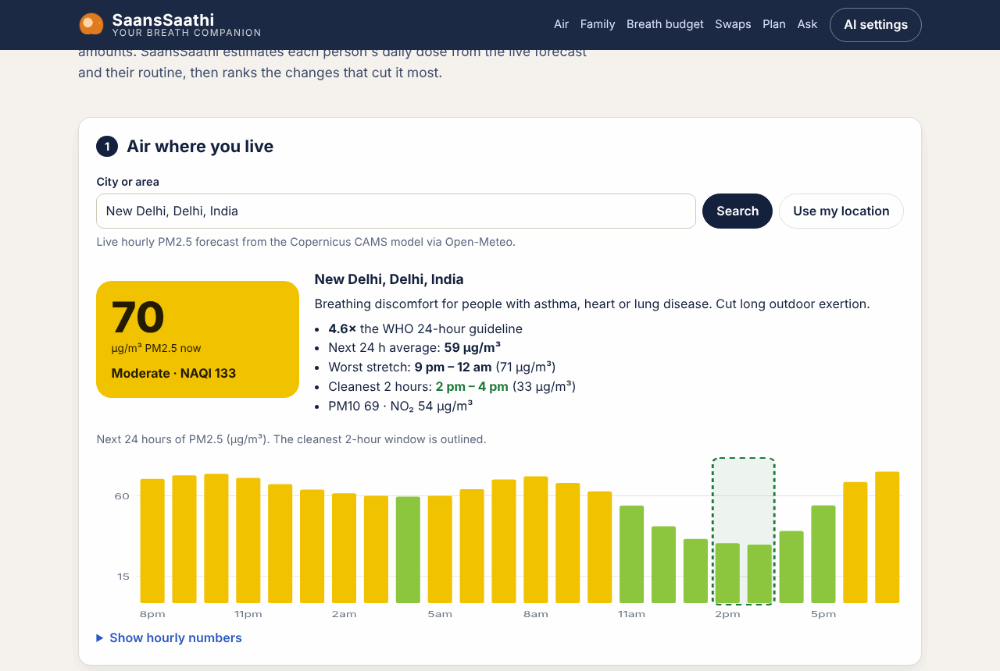
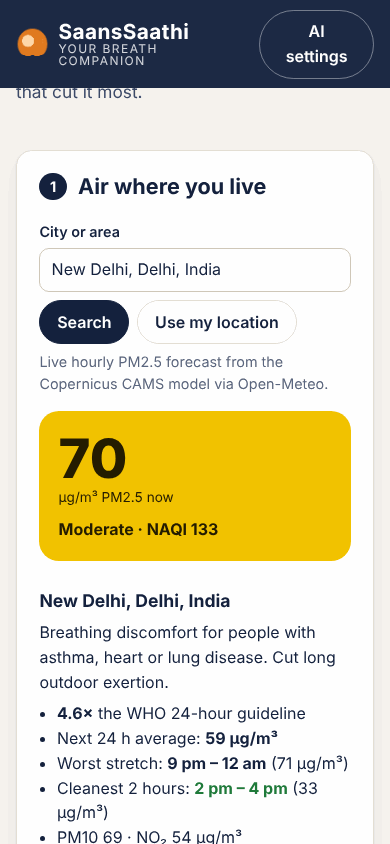
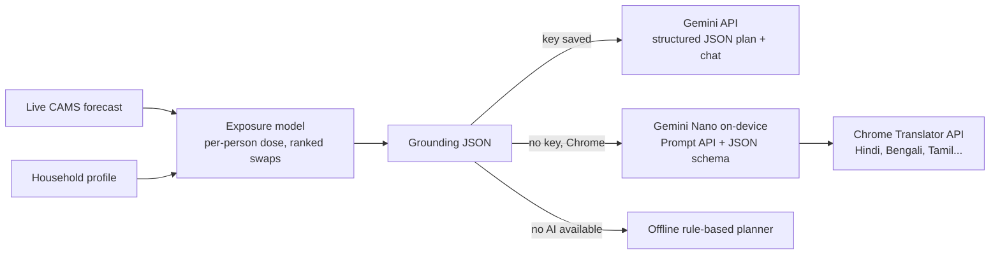

# SaansSaathi · Smog Copilot for Families

**PromptWars Virtual, Challenge 6: Urban Air Quality Assistant**

> AQI is the same for everyone in a city. Your dose isn't.

SaansSaathi ("breath companion" in Hindi: saans = breath, saathi = companion) is a generative-AI assistant that helps families get through winter smog. It does more than show a city AQI number. It estimates **how much PM2.5 each family member actually breathes in** over the next 24 hours, then ranks the choices that cut that dose most and explains the impact of each one in plain numbers.

**Live app:** https://profmohit-edu.github.io/saanssaathi/ · **Author:** [Prof. Mohit Tiwari](https://www.linkedin.com/in/mtiw/), Assistant Professor, Computer Science, Bharati Vidyapeeth's College of Engineering, New Delhi

| Air & clean-air window | Swap simulator (dark mode) | Mobile |
|---|---|---|
|  |  |  |

## What makes it different

| Typical AQI app | SaansSaathi |
|---|---|
| One number per city | A **Breath Budget** per person: inhaled µg/day, cigarette equivalent, × WHO guideline |
| "Avoid going outside" | **Clean-air windows** from the live hourly forecast, e.g. "go out 2–4 pm, it's 33 µg/m³" |
| Generic tip lists | A **swap simulator** that re-runs the exposure model for each change and ranks swaps by dose avoided (and CO₂ saved) |
| English only | **Gemini** writes a personalised plan and answers questions in English, Hindi, Bengali, Tamil, Telugu, Marathi or Punjabi |
| Ignores the home | Models indoor sources such as incense, mosquito coils, solid fuel and smoking, plus windows and purifiers |

## Features

1. **Air where you live**: live hourly PM2.5 forecast (Copernicus CAMS via Open-Meteo, no key needed), India NAQI band, worst stretch, cleanest window, and an accessible chart with a table version.
2. **Household builder**: each person's age group, health conditions (asthma, heart, pregnancy), commute mode and hours, outdoor time, activity level and mask. Home settings cover windows, purifier and indoor sources.
3. **Breath Budget**: an exposure model across sleep, indoors, commute and outdoors.
4. **Swap simulator**: about 13 evidence-based swaps (N95, timing, metro, recirculation, sealing, a DIY Corsi–Rosenthal filter, clean cooking fuel and more). Each is scored by the model, can be ticked to combine, and shows its effect per person.
5. **Tomorrow's plan**: built-in offline planner, or **Gemini structured JSON output** with a schedule, advice for each person and an "impact story".
6. **Ask SaansSaathi**: a Gemini chat grounded in the family's own computed numbers.
7. **Clean the air on your street**: actions tailored to the city, such as the Green Delhi app in Delhi-NCR, CPCB's Sameer app across India, RWA no-burn drives, and metro or carpool depending on whether the city has metro rail.
8. **Indoor hacks and myth-busting**: for example, morning walks are often the *dirtiest* hours in winter smog.

## Generative AI usage

SaansSaathi picks the best AI available, so every visitor gets AI help:



* **Gemini API** (`gemini-3.6-flash` by default, configurable) in `src/gemini.js`:
  * `generatePlan()` uses `responseMimeType: application/json` and a `responseSchema` to produce a validated day plan in the user's language.
  * `ask()` runs a multi-turn chat grounded in a compact JSON context (forecast, per-person dose, ranked swaps), so the model explains real figures instead of making them up.
* **Gemini Nano, built into Chrome** (`src/ai/nano.js`): the same plan and chat run on the device through the Prompt API, with a JSON-schema `responseConstraint`. The Translator API then turns the answer into Indian languages on the device. No key, no server, no data leaves the browser.
* `src/ai/provider.js` chooses between cloud, on-device and offline, and the page shows which one is active.
* A shared system instruction enforces grounding, no diagnosis, cost-aware advice and resistance to prompt injection.

## Architecture

```
index.html              semantic shell, strict CSP, no inline JS/CSS
styles.css              responsive, high-contrast, reduced-motion aware
src/
  app.js                controller: owns state, runs the model, triggers renders
  config.js             every tunable constant (timeouts, limits, thresholds)
  types.js              shared JSDoc types (checked by the TypeScript compiler)
  format.js             pure formatting helpers
  ui/
    air-view.js         place search, live reading, 24 h chart
    household-view.js   home settings and member cards
    results-view.js     Breath Budget, swap simulator, plan, guidance
    assistant-view.js   Gemini plan, grounded chat, settings dialog
  api.js                Open-Meteo clients: timeout, TTL cache, validation
  environment.js        forecast → environment (slots, rush hour, best windows)
  windows.js            clean-air / peak / ventilation window detection
  exposure.js           Breath Budget dose model
  swaps.js              what-if simulator & ranking
  engine.js             offline planner, rule-based health alerts, hacks, myths
  gemini.js             Gemini prompts, schema, REST client, parsing
  ai/nano.js            on-device Gemini Nano + Translator (no key)
  ai/provider.js        picks cloud / on-device / offline
  ui/share.js           share plan via share sheet or WhatsApp
  aqi.js                NAQI + US EPA (2024) PM2.5 indices
  local.js              city tailoring: metro availability, complaint channels
  chart.js              dependency-free SVG chart + table
  dom.js                XSS-safe DOM builder & rich-text tokenizer
  store.js              validated persistence (localStorage / sessionStorage)
tests/                  75 unit tests (node:test) + 5 end-to-end browser tests (Playwright)
```

The model layer (`exposure`, `swaps`, `environment`, `engine`, `gemini`) has no DOM code and is unit-tested directly. Views only render state and report edits back to the controller through a small `actions` interface.

No framework, no build step and no runtime dependencies. The page is under 100 KB.

## Code quality

| Check | Tool | Command |
|---|---|---|
| Lint (no errors, complexity ≤ 12, max 250 lines/file) | ESLint 10 | `npm run lint` |
| Formatting | Prettier | `npm run format:check` |
| Static types (strict, `checkJs`) | TypeScript | `npm run typecheck` |
| Unit tests + coverage | `node:test` | `npm run test:coverage` |
| End-to-end (real Chromium) | Playwright | `npm run test:e2e` |
| Everything | | `npm run check` |

GitHub Actions runs all of them on every push.

### The exposure model

`dose = Σ concentration × breathing rate × hours` across four micro-environments.

* Breathing rates: US EPA *Exposure Factors Handbook* (sleep 0.4, rest 0.5, light 0.8, moderate 1.6, vigorous 3.0 m³/h), scaled by age group.
* In-vehicle ratios: car with recirculation 0.5, metro 0.6, bus 1.2, two-wheeler and auto 1.4.
* Indoor/outdoor infiltration: 0.9 with windows open, 0.6 closed, 0.3 closed with a filter. Indoor sources add on top.
* Mask penetration (real-world fit): N95 0.25, surgical 0.7, cloth 0.85.
* Cigarette equivalent: Berkeley Earth's rule of thumb, 22 µg/m³ for a day ≈ 1 cigarette (330 µg inhaled).

These figures are estimates for ranking choices, not medical measurements.

### References

* US EPA, [Exposure Factors Handbook, Chapter 6: Inhalation Rates](https://www.epa.gov/expobox/exposure-factors-handbook-chapter-6)
* Berkeley Earth, [Air Pollution and Cigarette Equivalence](https://berkeleyearth.org/air-pollution-and-cigarette-equivalence/)
* WHO, [Global Air Quality Guidelines (2021)](https://www.who.int/publications/i/item/9789240034228)
* Central Pollution Control Board, [National Air Quality Index](https://cpcb.nic.in/)
* Copernicus Atmosphere Monitoring Service via [Open-Meteo Air Quality API](https://open-meteo.com/en/docs/air-quality-api)

## Security

See [SECURITY.md](SECURITY.md) for the threat model.


* Strict Content-Security-Policy: `script-src 'self'`, `connect-src` limited to Open-Meteo and Gemini, `object-src 'none'`, `base-uri 'none'`.
* No `innerHTML` with dynamic data. All text, including model output, is rendered as text nodes.
* The Gemini key comes from the user, is stored in `sessionStorage` by default (opt-in `localStorage`), and is sent in the `x-goog-api-key` header, never in a URL.
* All stored and imported state is validated and clamped (`sanitizeState`). The model name is regex-checked.
* `referrerPolicy: no-referrer` on every request, with timeouts via `AbortController`.

## Accessibility

Skip link, landmarks, labelled form controls, `aria-live` result regions, keyboard-navigable place search, a chart with a text summary and data table, 44 px touch targets, visible focus rings, colour bands that never carry meaning alone, and `prefers-reduced-motion` support.

## Run locally

```bash
npm install       # dev tools only: eslint, prettier, typescript
npm run check     # lint + format + types + unit tests
npm run test:e2e  # browser tests (after: npx playwright install chromium)
npm start         # serves on http://localhost:8080
```

Open the app, click **AI settings** and paste a free Gemini API key from https://aistudio.google.com/apikey. Everything except Gemini works without a key.

## Data and credits

Air quality: [Open-Meteo Air Quality API](https://open-meteo.com/en/docs/air-quality-api) (Copernicus Atmosphere Monitoring Service). AI: Google Gemini. Licence: MIT.
