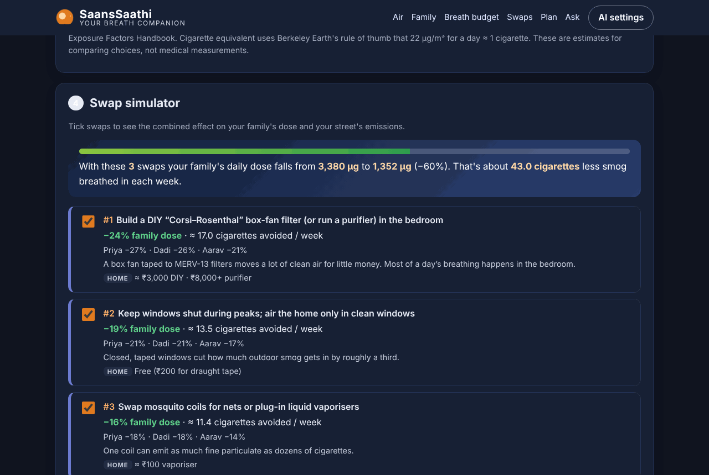
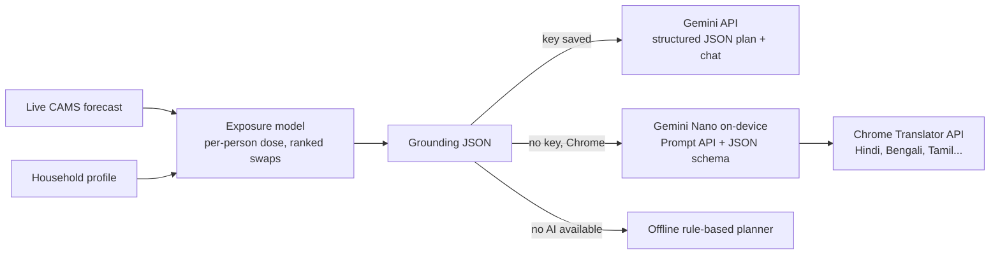

# SaansSaathi · Smog Copilot for Families

**PromptWars Virtual, Challenge 6: Urban Air Quality Assistant**

> AQI is the same for everyone in a city. Your dose isn't.

SaansSaathi ("breath companion" in Hindi) is a generative-AI assistant that helps families get through winter smog. It estimates **how much PM2.5 each family member actually breathes in** over the next 24 hours, then recommends low-emission routines, indoor-air fixes and greener swaps for that family's city and lifestyle, and explains the impact of each choice in numbers.

**Live app:** https://profmohit-edu.github.io/saanssaathi/ · **Author:** [Prof. Mohit Tiwari](https://www.linkedin.com/in/mtiw/), Bharati Vidyapeeth's College of Engineering, New Delhi

| Air and clean-air window | Swap simulator (dark mode) | Mobile |
|---|---|---|
|  |  |  |

## Chosen vertical and persona

* **Vertical:** Urban Air Quality Assistant (Challenge 6).
* **Persona:** a family in a North Indian city during winter smog, often several generations under one roof. For example, a two-wheeler commuter, a parent working from home, a school-age child, and a grandparent with asthma who takes a 6 am walk.
* **The persona's problem:** they see one city AQI number. It doesn't tell them who in the family is most exposed, when to go out, or which changes are worth making.

## Approach and logic

The assistant reasons from the user's context in three steps. Each step is plain, testable code; generative AI only explains and personalises the results.

1. **Measure each person's dose.** For every family member, `exposure.js` computes inhaled PM2.5 as `concentration × breathing rate × hours` across sleep, indoors, commute and outdoors. Inputs: the live forecast, age group, commute mode, outdoor time and activity, mask, windows, purifier, and what is burned at home.
2. **Find the right time.** `windows.js` scans the hourly forecast for the cleanest 2-hour window, the worst 3-hour stretch, rush-hour levels, and the hours when outdoor air is cleaner than indoor air (safe to ventilate).
3. **Decide what to change.** `swaps.js` applies each candidate change to a copy of the household, re-runs the dose model and ranks the changes by dose avoided. Only relevant swaps are offered: no N95 suggestion for someone who never goes out, no metro suggestion in a city without one. Community swaps also report CO₂ saved.

The decisions that follow are rule-based and context-aware:

| Context | Decision |
|---|---|
| Member has asthma and air is not Good | Health alert; level rises when air is Poor or worse |
| Child or senior doing vigorous outdoor activity on a Poor day | Move activity indoors |
| Outdoor time in a dirty slot | "Move it to the cleanest window", with the dose saved |
| City has metro rail (`local.js`) | Suggest the metro; otherwise an AC bus or carpool |
| Delhi-NCR | Report burning on the Green Delhi app; elsewhere in India, CPCB's Sameer app |
| No hour cleaner than indoor air | "Don't open windows today" |
| Gemini key saved / Chrome with Gemini Nano / neither | Cloud AI / on-device AI / offline planner |

## How the solution works

1. Search a city or use your location. `api.js` fetches the hourly PM2.5 forecast (Copernicus CAMS via Open-Meteo) and caches it; if the service is down, the last saved forecast is shown with its time.
2. Describe the household, or load the demo family. Edits are validated and saved in the browser only.
3. **Breath Budget** shows each person's dose in µg, cigarette equivalents and multiples of the WHO guideline, broken down by where it happens.
4. **Swap simulator** ranks changes. Tick several to see the combined cut, per person, and the CO₂ saved.
5. **Tomorrow's plan** is a schedule built around the clean and dirty windows. **Personalise with Gemini** rewrites it for each person in the chosen language:
   * with a Gemini API key: the Gemini API with structured JSON output;
   * with no key in Chrome: **Gemini Nano on the device**, translated on the device by Chrome's Translator API.
6. **Ask SaansSaathi** answers questions using the family's own numbers.
7. **Share plan** sends the plan to WhatsApp or the phone's share sheet.



## Assumptions

* **Breathing rates** follow the US EPA Exposure Factors Handbook (sleep 0.4, rest 0.5, light 0.8, moderate 1.6, vigorous 3.0 m³/h for adults), scaled by age group.
* **Each person sleeps 8 hours indoors.** Commute and outdoor hours come from the user, and the rest of the day is spent indoors.
* **Indoor air** is 90% of outdoor PM2.5 with windows open, 60% closed, and 30% closed with a purifier. Indoor sources (incense, coils, solid fuel, smoking, kerosene, unvented gas) add fixed daily amounts.
* **In-vehicle exposure** relative to outside air: car on recirculation 0.5, metro 0.6, bus 1.2, two-wheeler and auto 1.4.
* **Masks** let through 25% (well-fitted N95), 70% (surgical) or 85% (cloth) of fine particles.
* **Commutes happen at rush hour** (8–10 am and 6–8 pm); outdoor time follows the slot the user picks.
* **The forecast is accurate enough to plan with.** It is a model forecast, not a CPCB station reading.
* **Cigarette equivalent** uses Berkeley Earth's rule of thumb: 22 µg/m³ breathed for a day ≈ 1 cigarette.
* **Clock times** use the browser's time zone, which is correct for users planning in their own city.

These are estimates for comparing choices, not medical measurements. The app gives general guidance and tells users to see a doctor about symptoms.

## Generative AI usage

* **Gemini API** (`gemini-3.6-flash` by default, configurable) in `src/gemini.js`: `generatePlan()` uses `responseMimeType: application/json` with a `responseSchema`; `ask()` is a multi-turn chat. Both are grounded in a compact JSON context (local-time forecast windows, per-person dose, ranked swaps), so the model explains real figures instead of inventing them.
* **Gemini Nano, built into Chrome** (`src/ai/nano.js`): the same plan and chat run on the device through the Prompt API with a JSON-schema `responseConstraint`, then the Translator API renders Indian languages. No key, no server, and no data leaves the browser.
* `src/ai/provider.js` chooses cloud, on-device or offline, and the page shows which one is active.
* A shared system instruction enforces grounding, no diagnosis, no harmful tips (such as air fresheners or incense) and resistance to prompt injection.

## Architecture

```
index.html              semantic shell, strict CSP, no inline JS/CSS
styles.css              responsive, dark mode, reduced-motion aware
src/
  app.js                controller: owns state, runs the model, triggers renders
  config.js             every tunable constant (timeouts, limits, thresholds)
  types.js              shared JSDoc types (checked by the TypeScript compiler)
  exposure.js           Breath Budget dose model
  windows.js            clean-air / peak / ventilation window detection
  environment.js        forecast → time slots, rush hour, best windows
  swaps.js              what-if simulator and ranking
  engine.js             offline planner, rule-based health alerts, tips
  local.js              city tailoring: metro availability, complaint channels
  aqi.js                India NAQI and US EPA (2024) PM2.5 indices
  gemini.js             Gemini prompts, schema, REST client, parsing
  ai/nano.js            on-device Gemini Nano + Translator
  ai/provider.js        picks cloud / on-device / offline
  api.js                Open-Meteo clients: timeout, cache, validation
  store.js              validated persistence and offline forecast cache
  format.js             pure formatting helpers
  dom.js                XSS-safe DOM builder and typed lookups
  chart.js              dependency-free SVG chart + data table
  ui/                   air, household, results, assistant and share views
tests/                  86 unit tests (node:test) + 18 browser tests (Playwright) covering every view
```

The model layer has no DOM code and is unit-tested directly. Views only render state and report edits to the controller through a small `actions` interface. There is no framework, no build step and no runtime dependency.

## Code quality and testing

| Check | Tool | Command |
|---|---|---|
| Lint (complexity ≤ 8, ≤ 45 lines per function, ≤ 4 parameters, ≤ 250 lines per file) | ESLint | `npm run lint` |
| Formatting | Prettier | `npm run format:check` |
| Static types (strict `checkJs`) | TypeScript | `npm run typecheck` |
| Unit tests with coverage | `node:test` | `npm run test:coverage` |
| End-to-end in real Chromium | Playwright | `npm run test:e2e` |

GitHub Actions runs all of them on every push.

## Security

See [SECURITY.md](SECURITY.md) for the threat model. In short: a strict Content-Security-Policy, no `innerHTML` with dynamic data (model output is rendered as text), the user's Gemini key kept in `sessionStorage` by default and sent only in the `x-goog-api-key` header, validated and clamped stored state, and timeouts with `no-referrer` on every request.

## Accessibility

Skip link, landmarks, labelled form controls (checked by an end-to-end test), `aria-live` result regions, keyboard-navigable place search, a chart with a text summary and data table, 44 px touch targets, visible focus rings, colour never used as the only signal, dark mode, and `prefers-reduced-motion` support.

## Run locally

```bash
npm install       # dev tools only: eslint, prettier, typescript, playwright
npm run check     # lint + format + types + unit tests
npm run test:e2e  # browser tests (after: npx playwright install chromium)
npm start         # serves on http://localhost:8080
```

In Chrome on a computer, AI works with no setup (Gemini Nano). Elsewhere, click **AI settings** and paste a free Gemini API key from https://aistudio.google.com/apikey.

## References

* US EPA, [Exposure Factors Handbook, Chapter 6: Inhalation Rates](https://www.epa.gov/expobox/exposure-factors-handbook-chapter-6)
* Berkeley Earth, [Air Pollution and Cigarette Equivalence](https://berkeleyearth.org/air-pollution-and-cigarette-equivalence/)
* WHO, [Global Air Quality Guidelines (2021)](https://www.who.int/publications/i/item/9789240034228)
* Central Pollution Control Board, [National Air Quality Index](https://cpcb.nic.in/)
* Copernicus Atmosphere Monitoring Service via the [Open-Meteo Air Quality API](https://open-meteo.com/en/docs/air-quality-api)

## Author

**Prof. Mohit Tiwari**, Assistant Professor, Computer Science, Bharati Vidyapeeth's College of Engineering, New Delhi · [LinkedIn](https://www.linkedin.com/in/mtiw/) · [GitHub](https://github.com/profmohit-edu)

Built for PromptWars Virtual 2026 (Google for Developers × Hack2skill). Licence: MIT.
